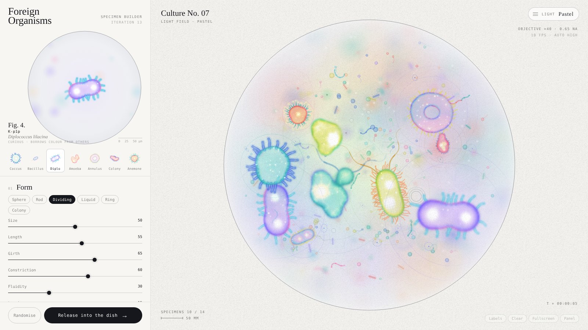

# Petri · Foreign Organisms

An interactive installation prototype: a living culture in a Petri dish, seen through a microscope.
Build your own micro-organism (shape, membrane, nuclei, appendages, colour, temperament) and release it into the dish,
where it lives among background life.

**Live:** open the GitHub Pages link of this repository.

## Controls

- **Left panel**: build an organism, then *Release into the dish*.
- **Light menu** (top right): Pastel / Lagoon / Fluorescence.
- Keys: `M` light · `T` labels · `R` random organism · `H` hide panel · `F` fullscreen · `Q` quality (auto / high / medium / low) · `Del` clear.

## Temperaments

- **Drifter**: swims in slow circles.
- **Curious**: visits others and borrows their colour for a while.
- **Restless**: darts at others and bumps them away.
- **Social**: drifts close to a neighbour and hangs out.

Up to 14 organisms live in the dish; the oldest dissolves into particles that feed the rest.

## Tech

Plain HTML, CSS and JavaScript (Canvas 2D), no build step, no dependencies.
Works when opened locally (`index.html`) or served from any static host.
